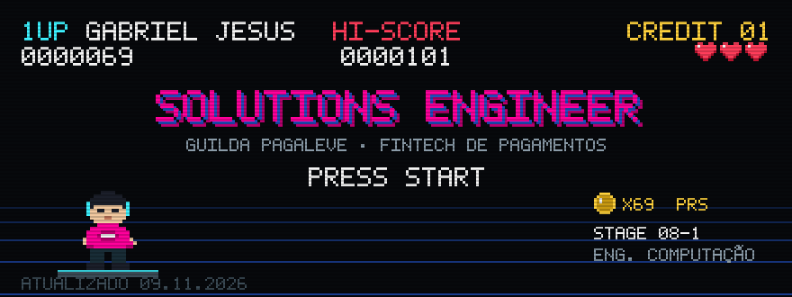
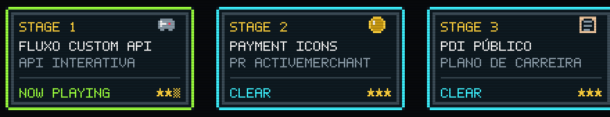
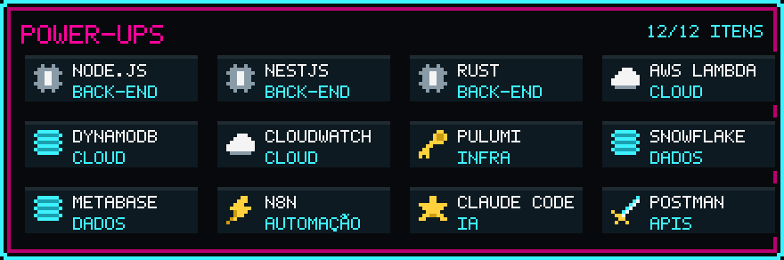

  

  <b>PLAYER 1 · GABRIEL JESUS · SOLUTIONS ENGINEER</b> 
  Fintech de pagamentos (Pix parcelado). Nível pleno. 
  Especial: <code>INTEGRAÇÃO</code> de plataformas de e-commerce · <code>AUTOMAÇÃO</code> de operações · <code>INCIDENTE</code> sob controle · <code>SUPORTE</code> técnico. 
  Combo: Engenharia + Produto + Comercial + CS + parceiros, no mesmo time. 
  Em treino: Engenharia da Computação, 8º semestre.

  

| Stage | Fase | Como jogar |
|:-:|---|---|
| **1** | [Fluxo Custom API Pagaleve](https://pagaleve-custom-api-flow.pages.dev) | Página interativa de como uma loja integra a Pagaleve via API: jornada em dez etapas, console de testes no sandbox, catálogo de erros, exemplos prontos. PT-BR e EN. |
| **2** | [`activemerchant/payment_icons` #1682](https://github.com/activemerchant/payment_icons/pull/1682) | Ícone da Pagaleve na biblioteca de ícones de pagamento do Active Merchant (Shopify). Open source, merged. |
| **3** | [PDI público](https://pdi-gabriel-jesus.gabriel-jesus-dev25.workers.dev) | Plano de Desenvolvimento Individual na web: trilhas, disciplinas e metas por trimestre. |

  

Itens ocultos: VTEX · Shopify · Nuvemshop · WooCommerce · Yampi · Wake · Datadog · Sentry · Jira · Lovable

  
  

  

  
  

© 2026 GABRIEL JESUS · TODOS OS CRÉDITOS INSERIDOS · placar atualizado em 09/11/2026

